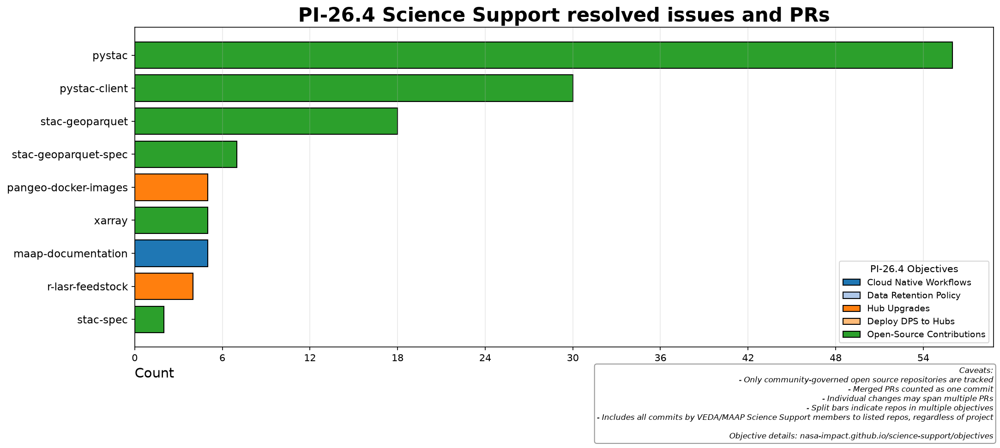
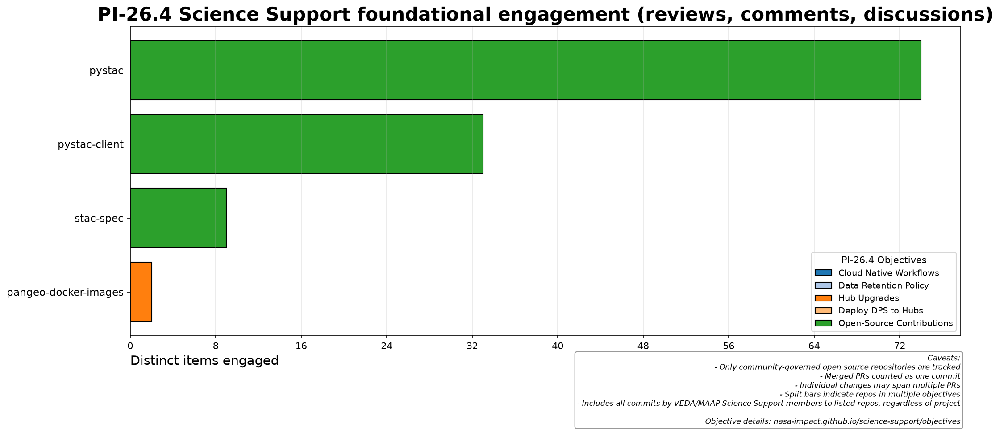
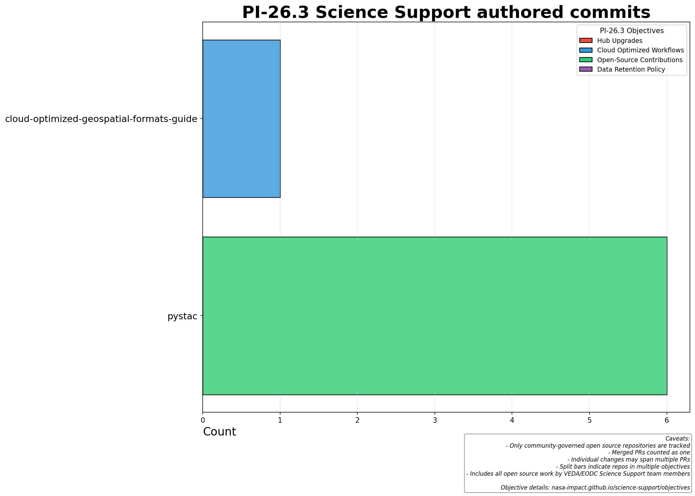
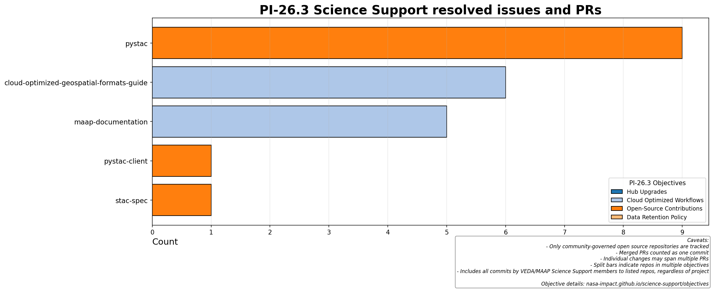
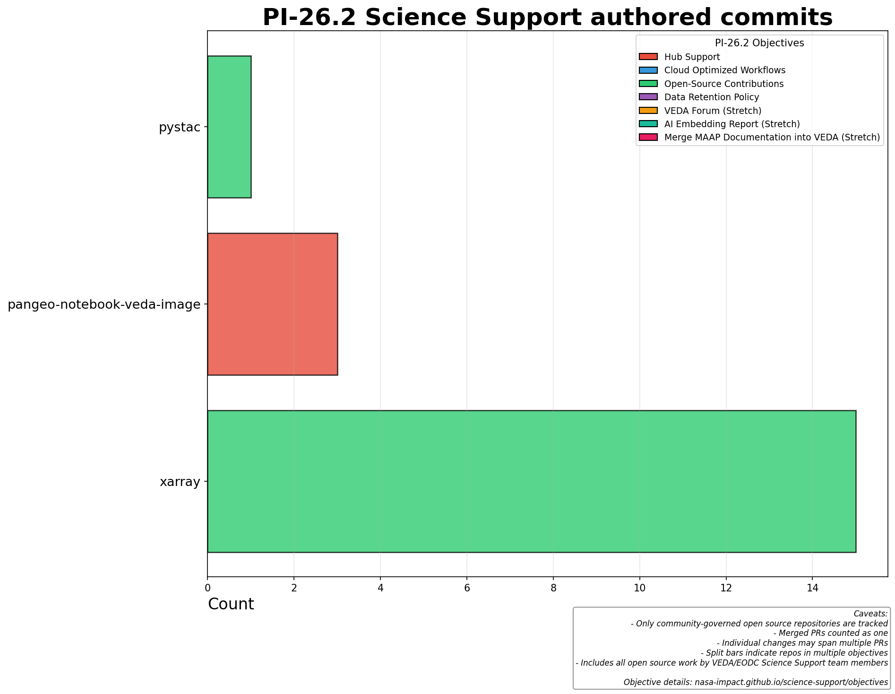
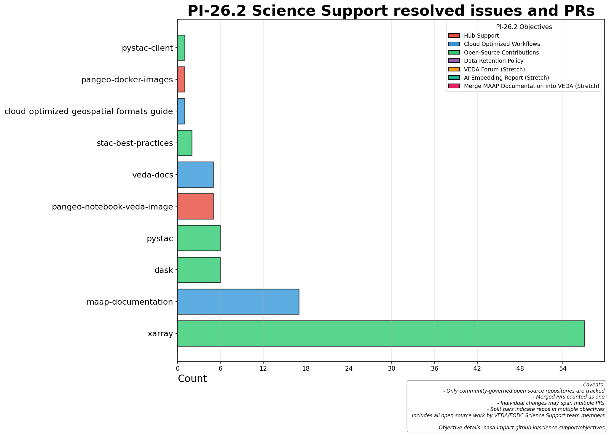

# Quarterly Objectives

This page tracks quarterly objectives for the VEDA/MAAP Science Support team and the open-source repositories they touch across Program Increments (PIs).

## Current PI: 27.1

| # | Objective | Contributors | Repos |
|---|-----------|--------------|-------|
| [#89](https://github.com/NASA-IMPACT/science-support/issues/89) | Hub Upgrades | wildintellect, jsignell | pangeo-docker-images, pangeo-notebook-veda-image |

---

## Past PIs

<details markdown>
<summary>PI 26.4 (5 original objectives; 5 closed as completed; 0 closed as not planned)</summary>

| # | Objective | State | Contributors |
|---|-----------|-------|--------------|
| [#62](https://github.com/NASA-IMPACT/science-support/issues/62) | Cloud Native Workflows | closed (completed) | omshinde |
| [#63](https://github.com/NASA-IMPACT/science-support/issues/63) | Data Retention Policy | closed (completed) | smk0033 |
| [#66](https://github.com/NASA-IMPACT/science-support/issues/66) | Hub Upgrades | closed (completed) | wildintellect |
| [#67](https://github.com/NASA-IMPACT/science-support/issues/67) | Deploy DPS to Hubs | closed (completed) | wildintellect |
| [#68](https://github.com/NASA-IMPACT/science-support/issues/68) | Open-Source Contributions | closed (completed) | gadomski |





</details>

<details markdown>
<summary>PI 26.3 (4 original objectives; 4 closed as completed; 0 closed as not planned)</summary>

| # | Objective | State | Contributors |
|---|-----------|-------|--------------|
| [#31](https://github.com/NASA-IMPACT/science-support/issues/31) | Hub Upgrades | closed (completed) | wildintellect, jsignell, weiji14, tylanderson, grallewellyn |
| [#32](https://github.com/NASA-IMPACT/science-support/issues/32) | Cloud Optimized Workflows | closed (completed) | wildintellect, hrodmn, omshinde, tylanderson, smk0033, HarshiniGirish |
| [#33](https://github.com/NASA-IMPACT/science-support/issues/33) | Open-Source Contributions | closed (completed) | gadomski, hrodmn, weiji14, tylanderson |
| [#34](https://github.com/NASA-IMPACT/science-support/issues/34) | Data Retention Policy | closed (completed) | smk0033 |





</details>

<details markdown>
<summary>PI 26.2 (7 original objectives; 4 closed as completed; 3 closed as not planned)</summary>

| # | Objective | State | Contributors |
|---|-----------|-------|--------------|
| [#1](https://github.com/NASA-IMPACT/science-support/issues/1) | Hub Support | closed (completed) | wildintellect, jsignell |
| [#2](https://github.com/NASA-IMPACT/science-support/issues/2) | Cloud Optimized Workflows | closed (completed) | wildintellect, jsignell |
| [#3](https://github.com/NASA-IMPACT/science-support/issues/3) | Open-Source Contributions | closed (completed) | jsignell, ircwaves, tylanderson |
| [#9](https://github.com/NASA-IMPACT/science-support/issues/9) | Data Retention Policy | closed (completed) | smk0033 |
| [#10](https://github.com/NASA-IMPACT/science-support/issues/10) | VEDA Forum (Stretch) | closed (not planned) | smk0033 |
| [#11](https://github.com/NASA-IMPACT/science-support/issues/11) | AI Embedding Report (Stretch) | closed (not planned) | omshinde |
| [#12](https://github.com/NASA-IMPACT/science-support/issues/12) | Merge MAAP Documentation into VEDA (Stretch) | closed (not planned) | - |





</details>

---

## Configuration

Objectives data lives in [`reports/_objectives_data.json`](https://github.com/NASA-IMPACT/science-support/blob/main/reports/_objectives_data.json) — auto-generated from GitHub issues by `dse_oss_reports.generator.ObjectivesGenerator`.

To regenerate this page:

```bash
uvx --from "dse-oss-reports @ git+https://github.com/NASA-IMPACT/dse-oss-reports.git" \
  dse-oss-reports --config team.toml generate-docs
```
